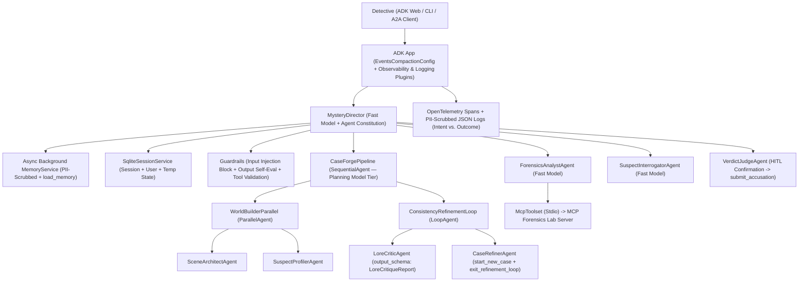

# Interactive AI Mystery Engine (`mystery-engine-adk`)

> **AI in 5 Days — L200 Freestyle Track Project**
> Built with **Google Agent Development Kit (ADK-Python)**, **Model Context Protocol (MCP)**, **Agent-to-Agent (A2A)**, strategic Gemini model routing, Human-in-the-Loop (HITL) confirmations, PII-redacted OpenTelemetry observability, persistent sessions & async background memory, automated ADK evaluations, and **Terraform** IaC + CI/CD.

## Problem & Solution

**The Problem:**
Interactive mystery games suffer from two broken extremes: scripted games break on unexpected player questions, while single-prompt LLM chatbots hallucinate contradictory alibis, forget earlier clues, blur state across sessions, and leak the culprit immediately if prompt-injected.

**The Solution:**
The **Interactive AI Mystery Engine** decomposes gameplay into a stateful multi-agent Google ADK system:
- A **Sequential → Parallel → Loop Case Forge** (`CaseForgePipeline`) uses a higher-reasoning planning tier to generate original mysteries and audit lore consistency with strict structured JSON (`LoreCritiqueReport`) before play starts.
- Specialized low-latency sub-agents handle **Forensics Lab analysis via MCP** (`McpToolset`), **in-character suspect interrogations**, and **Human-in-the-Loop confirmed verdicts** (`ToolContext.request_confirmation`).
- **Layered input + output self-eval guardrails** prevent prompt-injection and accidental culprit leaks, while **SQLite sessions**, **PII-scrubbed async background memory consolidation**, and **ADK `EventsCompactionConfig`** keep long investigations coherent and safe.

---

## Architecture




## Quickstart & ADK CLI Usage

### 1. Clone & Configure

```bash
git clone <your-public-repo-url>
cd <repo-name>
cp .env.example .env
# Add GOOGLE_API_KEY to .env (stays local; never committed)
```

### 2. Install Dependencies

```bash
uv sync --extra dev --extra a2a
```

### 3. Run with Google ADK CLI & Local Entrypoints

- **ADK Web UI (browser chat, agent graph, state & trace explorer):**
  ```bash
  uv run adk web .
  ```
- **ADK Terminal CLI:**
  ```bash
  uv run adk run mystery_engine
  ```
- **ADK CLI Evaluation against Golden EvalSet:**
  ```bash
  uv run adk eval mystery_engine evals/mystery_engine.evalset.json --config_file_path evals/test_config.json
  ```
- **Interactive Python CLI / Offline Walkthrough / Health Check:**
  ```bash
  uv run python main.py --health   # Offline wiring & model-routing check
  uv run python main.py --demo     # End-to-end local walkthrough (no API key needed)
  uv run python main.py            # Interactive terminal detective mode
  ```
- **A2A Protocol Server (Agent Card at `http://localhost:8001/.well-known/agent.json`):**
  ```bash
  uv run python -m mystery_engine.a2a_server
  ```

---

## Testing, Evals & Local Tracing

```bash
# Lint & full offline test suite (tools, HITL, guardrails, PII redaction, MCP, SQLite, async memory, OTel, eval schemas)
uv run ruff check .
uv run pytest -v

# Live ADK AgentEvaluator suite (requires GOOGLE_API_KEY)
uv run pytest tests/test_evals.py -v -m eval

# Local Docker Compose stack with Jaeger OpenTelemetry UI (http://localhost:16686)
docker compose up --build
```

---

## Infrastructure as Code (Terraform) & Cloud Deployment

### Option A: Terraform IaC (`infra/terraform/`)
Provisions GCP APIs, Artifact Registry, least-privilege runtime Service Account, Secret Manager secret, GCS staging bucket, and Cloud Run v2 with Cloud Trace & Cloud DLP enabled:

```bash
cd infra/terraform
cp terraform.tfvars.example terraform.tfvars
# Edit terraform.tfvars with your project_id and container_image
terraform init
terraform plan
terraform apply
```

### Option B: ADK CLI Deployment (`adk deploy`)
```bash
# Deploy directly to Google Cloud Run via ADK CLI
uv run adk deploy cloud_run \
  --project="${GOOGLE_CLOUD_PROJECT}" \
  --region="${GOOGLE_CLOUD_LOCATION:-us-central1}" \
  --service_name="mystery-engine-adk" \
  --with_ui \
  mystery_engine

# Or deploy to Vertex AI Agent Engine via ADK CLI / Python SDK
uv run python deploy/deploy_agent_engine.py
```

### Option C: Cloud Run Script
```bash
export GOOGLE_CLOUD_PROJECT="your-gcp-project-id"
export GOOGLE_CLOUD_LOCATION="us-central1"
./deploy/deploy_cloud_run.sh
```
