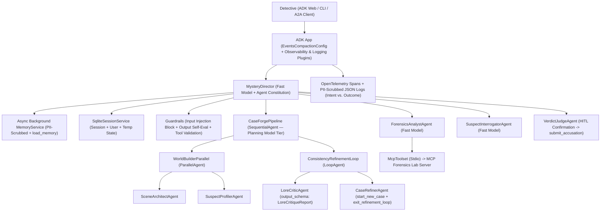

# Interactive AI Mystery Engine (`mystery-engine-adk`)

> **AI in 5 Days — L200 Freestyle Track Project**
> Built with **Google Agent Development Kit (ADK-Python)**, **Model Context Protocol (MCP)**, **Agent-to-Agent (A2A)**, strategic Gemini model routing, Human-in-the-Loop (HITL) confirmations, PII-redacted OpenTelemetry observability, persistent sessions & async background memory, automated ADK evaluations, and **Terraform** IaC + CI/CD.

## Problem & Solution

**The Problem:**
Interactive mystery games suffer from two broken extremes: scripted games break on unexpected player questions, while single-prompt LLM chatbots hallucinate contradictory alibis, forget earlier clues, blur state across sessions, and leak the culprit immediately if prompt-injected.

**The Solution:**
The **Interactive AI Mystery Engine** decomposes gameplay into a stateful multi-agent Google ADK system:
- A **Sequential → Parallel → Loop Case Forge** (`CaseForgePipeline`) uses a higher-reasoning planning tier to generate original mysteries and audit lore consistency with strict structured JSON (`LoreCritiqueReport`) before play starts.
- Specialized low-latency sub-agents handle **Forensics Lab analysis via MCP** (`McpToolset`), **in-character suspect interrogations**, and **Human-in-the-Loop confirmed verdicts** (`ToolContext.request_confirmation`).
- **Layered input + output self-eval guardrails** prevent prompt-injection and accidental culprit leaks, while **SQLite sessions**, **PII-scrubbed async background memory consolidation**, and **ADK `EventsCompactionConfig`** keep long investigations coherent and safe.

---

## Architecture



---

## AgentOps Code Review Matrix (95/95 Alignment)

| Category | Criterion (5 pts each) | Concrete Implementation in This Repo |
|---|---|---|
| **1. Tool & Interface Design** | Comprehensive Tool Docstrings | Full Google-style docstrings with purpose, args, and return contracts in `mystery_engine/tools/case_tools.py`, `mystery_engine/tools/mcp_forensics.py`, `mystery_engine/mcp_server/forensics_server.py`. |
| | Descriptive Naming | Domain-specific names: `start_new_case`, `inspect_clue`, `record_interrogation_note`, `list_case_status`, `submit_accusation`, `exit_refinement_loop`, `analyze_fingerprint`, `verify_alibi_timeline`, `decode_cipher_note`. |
| | Explicit JSON Schemas | Strict Pydantic input/output models (`StartCaseInput`, `InspectClueInput`, `ClueInspectionOutput`, `InterrogationNoteInput`, `AccusationInput`, `AccusationResult`, `CaseDossier`) + LLM `output_schema=LoreCritiqueReport` on `LoreCriticAgent` (`mystery_engine/schemas.py`). |
| | Guided Error Handling | Every tool & callback error returns structured `{"status": "error", "message": ..., "recovery_action": ...}` telling the LLM exactly how to recover. |
| **2. Context & Memory** | Robust System Instructions | Structured 4-section **Agent Constitution** (`MYSTERY_DIRECTOR_CONSTITUTION`) in `mystery_engine/agents/director.py` + role/protocol/constraint prompts on all specialists. |
| | History Compaction | ADK `EventsCompactionConfig(compaction_interval=4, overlap_size=1)` on `App` (`mystery_engine/agent.py`). |
| | Persistent Session State | `SqliteSessionService` backed by SQLite (`data/sessions/mystery_sessions.db`) with `session`, `user:`, and `temp:` scopes + `VertexAiMemoryBankService` cloud support (`mystery_engine/memory/services.py`). |
| | Async Memory Operations | Non-blocking background `asyncio.create_task` memory consolidation (`schedule_background_memory_consolidation`) dispatched by `auto_save_memory_callback` so UI turns never block. |
| **3. Orchestration & Logic** | Multi-Agent Patterns | Coordinator (`MysteryDirector`) + `SequentialAgent` (`CaseForgePipeline`) → `ParallelAgent` (`WorldBuilderParallel`) + `LoopAgent` (`ConsistencyRefinementLoop`) + 3 specialists + A2A (`to_a2a`). |
| | Strategic Model Routing | `select_model_for_role()` (`mystery_engine/agents/model_router.py`) routes fast interactive tasks to `MYSTERY_FAST_MODEL` (`gemini-3.5-flash`) and complex worldbuilding/critique to `MYSTERY_PLANNING_MODEL` (`gemini-3.8-flash`). |
| | Guardrails & Policy Plugins | Input prompt-injection blocker (`before_model_callback`), output spoiler self-eval check (`after_model_callback`), tool validation (`before_tool_callback`), plus ADK `BasePlugin` (`mystery_engine/callbacks/guardrails.py`). |
| | Human-in-the-Loop Hooks | High-stakes formal arrest tool `submit_accusation` invokes ADK `tool_context.request_confirmation(...)` and pauses (`status="pending_confirmation"`) until explicit human detective approval (`mystery_engine/tools/case_tools.py`). |
| **4. Observability & Tracing** | Structured JSON Logging | Single-line JSON log formatter (`JsonLogFormatter`) with ISO timestamps, trace/span IDs, and structured metadata (`mystery_engine/observability/logging_config.py`). |
| | Intent vs. Outcome Capture | `MysteryObservabilityPlugin` explicitly records `tool_intent` before execution and pairs it with `tool_intent_vs_outcome` (`intent_succeeded`, `outcome_status`, `latency_ms`) after execution (`mystery_engine/observability/plugin.py`). |
| | Distributed Tracing | OpenTelemetry `TracerProvider` (OTLP/Jaeger, Console, Google Cloud Trace) with linked parent/child agent and tool execution spans (`mystery_engine/observability/telemetry.py`). |
| | PII Redaction | Active PII scrubber (`mystery_engine/observability/pii_redaction.py`) supporting Google Cloud DLP API (`ENABLE_CLOUD_DLP=true`) plus always-on regex scrubbing wired into **both** JSON logging and long-term memory pipelines. |
| **5. Infrastructure & CI/CD** | Automated Evaluation Suites | ADK golden eval dataset (`evals/mystery_engine.evalset.json`, `evals/test_config.json`) validated offline against ADK `EvalSet` schema + live `AgentEvaluator` tests (`tests/test_evals.py`). |
| | Infrastructure as Code & ADK CLI | Production Terraform IaC (`infra/terraform/main.tf`, `variables.tf`, `outputs.tf`), multi-stage `Dockerfile`, `docker-compose.yml`, GitHub Actions CI (`.github/workflows/ci.yml`), and ADK CLI usage documented below. |
| | Secure Secret Management | Zero hardcoded keys; `.env` gitignored; runtime Secret Manager client (`mystery_engine/secrets.py`), Terraform `secret_key_ref`, and Cloud Run `--set-secrets`. |

---

## Quickstart & ADK CLI Usage

### 1. Clone & Configure

```bash
git clone <your-public-repo-url>
cd <repo-name>
cp .env.example .env
# Add GOOGLE_API_KEY to .env (stays local; never committed)
```

### 2. Install Dependencies

```bash
uv sync --extra dev --extra a2a
```

### 3. Run with Google ADK CLI & Local Entrypoints

- **ADK Web UI (browser chat, agent graph, state & trace explorer):**
  ```bash
  uv run adk web .
  ```
- **ADK Terminal CLI:**
  ```bash
  uv run adk run mystery_engine
  ```
- **ADK CLI Evaluation against Golden EvalSet:**
  ```bash
  uv run adk eval mystery_engine evals/mystery_engine.evalset.json --config_file_path evals/test_config.json
  ```
- **Interactive Python CLI / Offline Walkthrough / Health Check:**
  ```bash
  uv run python main.py --health   # Offline wiring & model-routing check
  uv run python main.py --demo     # End-to-end local walkthrough (no API key needed)
  uv run python main.py            # Interactive terminal detective mode
  ```
- **A2A Protocol Server (Agent Card at `http://localhost:8001/.well-known/agent.json`):**
  ```bash
  uv run python -m mystery_engine.a2a_server
  ```

---

## Testing, Evals & Local Tracing

```bash
# Lint & full offline test suite (tools, HITL, guardrails, PII redaction, MCP, SQLite, async memory, OTel, eval schemas)
uv run ruff check .
uv run pytest -v

# Live ADK AgentEvaluator suite (requires GOOGLE_API_KEY)
uv run pytest tests/test_evals.py -v -m eval

# Local Docker Compose stack with Jaeger OpenTelemetry UI (http://localhost:16686)
docker compose up --build
```

---

## Infrastructure as Code (Terraform) & Cloud Deployment

### Option A: Terraform IaC (`infra/terraform/`)
Provisions GCP APIs, Artifact Registry, least-privilege runtime Service Account, Secret Manager secret, GCS staging bucket, and Cloud Run v2 with Cloud Trace & Cloud DLP enabled:

```bash
cd infra/terraform
cp terraform.tfvars.example terraform.tfvars
# Edit terraform.tfvars with your project_id and container_image
terraform init
terraform plan
terraform apply
```

### Option B: ADK CLI Deployment (`adk deploy`)
```bash
# Deploy directly to Google Cloud Run via ADK CLI
uv run adk deploy cloud_run \
  --project="${GOOGLE_CLOUD_PROJECT}" \
  --region="${GOOGLE_CLOUD_LOCATION:-us-central1}" \
  --service_name="mystery-engine-adk" \
  --with_ui \
  mystery_engine

# Or deploy to Vertex AI Agent Engine via ADK CLI / Python SDK
uv run python deploy/deploy_agent_engine.py
```

### Option C: Cloud Run Script
```bash
export GOOGLE_CLOUD_PROJECT="your-gcp-project-id"
export GOOGLE_CLOUD_LOCATION="us-central1"
./deploy/deploy_cloud_run.sh
```
